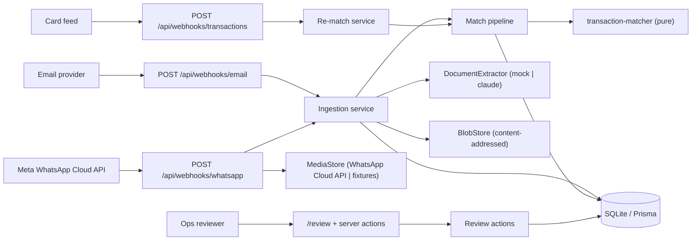
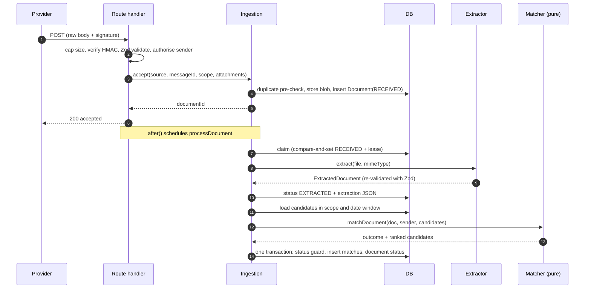
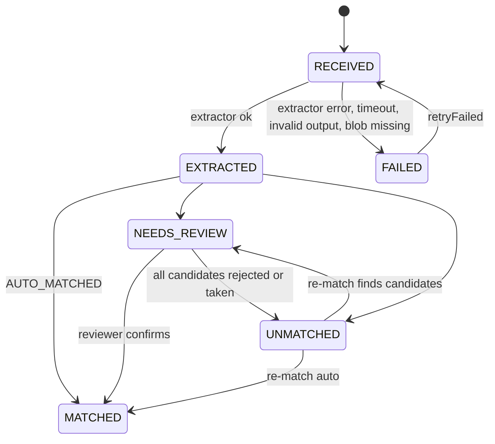
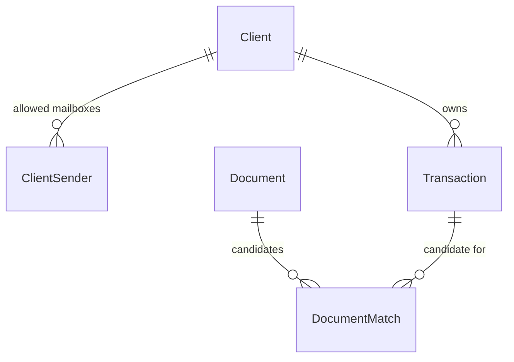

# Implementation notes

How the matching pipeline works, why it is built this way, and where it is weak. Setup and usage are in [README.md](README.md).

Contents: 1 Overview · 2 Pipeline · 3 Matching engine · 4 Data model and invariants · 5 Idempotency and concurrency · 6 Security and threat model · 7 Failure modes · 8 Assumptions · 9 Trade-offs and rejected alternatives · 10 Known limitations · 11 Multi-transaction invoices (design sketch) · 12 Testing · 13 Dependencies · 14 Production path

---

## 1. Overview

Layering rules: route files only wire dependencies. Handlers (`lib/webhooks/handlers`) take injected dependencies, so they are tested without Next, env vars or a network. The **matcher imports nothing but types, config and pure helpers** (ESLint forbids `@prisma`, `fs`, `path`, `@/lib/prisma` in those files), so the 30%-weight part of the system is deterministic and testable with plain objects.

## 2. Pipeline

Two phases, deliberately separate:

| Phase | Work | Why |
|---|---|---|
| **A. Accept** (inside the HTTP request) | cap body size, verify HMAC over the raw bytes, validate with Zod, authorise the sender, decode attachments, dedupe, store bytes, insert `Document(RECEIVED)`, respond `200` | The provider gets a fast answer. Meta and mail providers redeliver on slow or failed responses, so keeping the request short matters |
| **B. Process** (after the response, via `after()`) | claim the document, extract, validate the extractor output, load in-scope candidates, run the matcher, persist matches and status | Slow, may fail, may be retried. It is a plain function, so tests and a recovery sweep call it directly |

HTTP contract (a misconfigured environment is the one deliberate `500`): `200` accepted / ignored / duplicate, `400` invalid (field paths only, never the submitted values), `401` bad signature, `413` too large, `503` + `Retry-After` when the provider **should** retry (DB or blob store down before anything was durably accepted, a retryable media download failure, or our own expired WhatsApp token). Redelivery is safe because of the idempotency keys in section 5.

Status-only WhatsApp deliveries, text messages, stickers, unsupported MIME types and unknown email senders are acknowledged with `200` and **not stored**.

## 3. Matching engine

`matchDocument({ document, sender, candidates })` in `lib/services/transaction-matcher.ts`. All numbers live in `lib/config/matching.ts`.

### 3.1 Algorithm

1. **Usable?** `UNKNOWN` type, null/zero amount or null currency means `UNMATCHED / INSUFFICIENT_DATA` (a zero total would "exactly match" any zero-amount transaction).
2. **Hard filters**, before any scoring: drop transactions in a different currency or out of the sender's scope (WhatsApp: `driverPhone` equals the sender's E.164 number; email: `clientId` equals the sender's client). If none remain, `UNMATCHED / NO_CANDIDATES_IN_SCOPE`. A transaction that **already has a confirmed document is not dropped**: it is scored like any other and carries the flag `ALREADY_CONFIRMED` (see 3.6).
3. **Score** each remaining candidate (below). Every signal and every total is rounded to 4 decimals **before** any threshold or margin comparison, because `0.35 + 0.30 + 0.20 !== 0.85` in floating point.
4. **Rank** by score, then unconfirmed before already-confirmed, then smaller calendar-day difference, then transaction id (a total order, so input order never matters).
5. **Plausible** means `score >= 0.50`. None means `UNMATCHED / NO_PLAUSIBLE_CANDIDATE`.
6. **Decide.** `AUTO_MATCHED` only if **all** hold: top score ≥ 0.85, margin over the runner-up ≥ 0.10 (or no runner-up), OCR confidence ≥ 0.60, the top candidate's date was readable, and the top candidate is **not** already confirmed. Otherwise `NEEDS_REVIEW` with the first applicable reason: `LOW_EXTRACTION_CONFIDENCE`, `POSSIBLE_DUPLICATE`, `AMBIGUOUS`, `BELOW_AUTO_THRESHOLD`.

The result carries at most 5 plausible candidates, each with its score, per-signal values and flags, which are stored on `DocumentMatch.signals` and shown on the review page.

### 3.2 Score

`score = 0.45·amount + 0.25·merchant + 0.20·date + 0.10·card`

| Signal | Definition |
|---|---|
| **amount** (0.45) | `d = charge − invoice`. `d = 0` → 1.00. `|d| ≤ 5 halalas` (rounding) → 0.97. `0 < d ≤ 20%` of the invoice (tip) → `0.85 − 0.45·d/tipMax`, falling from 0.85 to 0.40, flag `TIP_SUSPECTED`. Charge **below** the invoice → 0 (flag `AMOUNT_BELOW_CHARGE`). Also tried against `invoice × 1.15` (document shows the pre-VAT total) for the exact and rounding rows only, ×0.90, flag `PRE_VAT_AMOUNT` |
| **merchant** (0.25) | Normalize both names, then `max(token-set ratio, Jaro-Winkler on the space-less string)`. A token subset scores 1.0, so "Aramco Retail Station 0412" matches "ARAMCO RETAIL 0412" |
| **date** (0.20) | Calendar days in UTC+3. A document date is ISO 8601: a date-only value (`2026-10-01`) is that calendar day; a datetime with `Z` or an offset (`2026-10-01T22:30:00Z`) is converted to an instant and its Riyadh day is used (here 2026-10-02). Same day 1.0. Invoice 1/2/3 days **before** the charge (settlement lag) 0.8/0.6/0.4. Invoice 1 day **after** the charge 0.7. Else 0. Unreadable date 0.5 with flag `DATE_MISSING` |
| **card** (0.10) | Both last4 known and equal → 1. Both known and different → 0 **and** the total is halved (`CARD_MISMATCH`). Either unknown → no contribution and **no renormalization** |

Gate: if the amount signal is below 0.05, the total is capped at 0.49 (below the review floor). A matching merchant and date must never make up for a wrong amount.

### 3.3 Worked examples (all reproduced in the tests and in the live demo)

| Case | Calculation | Result |
|---|---|---|
| Exact match, no last4 | 0.45 + 0.25 + 0.20 = **0.90** | AUTO |
| Two identical transactions, same day and merchant | 0.90 and 0.90, margin 0 | NEEDS_REVIEW (`AMBIGUOUS`) |
| Same pair, document has last4 matching one | 1.00 vs 0.90 × 0.5 = 0.45 (below the floor) | AUTO to the matching one |
| Rounding (231.00 vs 231.03) | 0.45·0.97 + 0.25 + 0.20 = **0.8865** | AUTO |
| 10% tip (60.00 vs 66.00) | 0.45·0.625 + 0.25 + 0.20 = **0.73** | NEEDS_REVIEW (`TIP_SUSPECTED`). Even a matching last4 only reaches 0.83. Only a tip of about 5% or less with a last4 match auto-matches |
| Pre-VAT total (100.00 vs 115.00) | 0.45·0.90 + 0.25 + 0.20 = **0.855** | AUTO (flag `PRE_VAT_AMOUNT`), just above 0.85 |
| Right merchant and date, wrong amount | capped at 0.49 | UNMATCHED |
| Exact match, OCR confidence 0.45 | 0.90 but confidence < 0.60 | NEEDS_REVIEW (`LOW_EXTRACTION_CONFIDENCE`) |
| Exact match on a transaction that already has a confirmed document (a second copy of the receipt) | 0.90, scored normally, flag `ALREADY_CONFIRMED` | NEEDS_REVIEW (`POSSIBLE_DUPLICATE`), at any score |
| The assignment's merchant pair: "Alfanar Fuel Station" vs "ALFANAR FUEL ST 04 RUH", same amount and day | both normalize to `fanar fuel station` (merchant 1.00): 0.45 + 0.25 + 0.20 = **0.90** | AUTO |
| The assignment's restaurant receipt 57.50 vs a 63.25 charge (10% tip) | 0.45·0.625 + 0.25 + 0.20 = **0.73125** | NEEDS_REVIEW (`TIP_SUSPECTED`) |

### 3.4 Why these numbers (and what would change them)

- **Amount is the heaviest signal and the gate.** Merchant strings from card networks and OCR are noisy ("ARAMCO RETAIL 0412" vs "Aramco Retail Station 0412"), and dates drift by settlement lag. The amount is the only field that is usually exact on both sides, so it decides plausibility.
- **0.85 / margin 0.10 are precision-first defaults.** A wrong auto-match silently attaches the wrong receipt to a VAT filing; a wrong review item costs a human one click. A perfect no-last4 match is worth 0.90, so the auto threshold needs a near-perfect match on the other three signals. The numbers are judgment calls: there is no labelled data in this exercise. In production they would be tuned against reviewers' confirm/reject decisions, tracking auto-match error rate rather than match rate.
- **Tips are not auto-matched.** A tip-sized difference is the main way two different transactions at the same merchant look alike.
- **Missing date blocks auto-match explicitly.** Without a date a perfect no-last4 match peaks at 0.80, but a card match could lift it to 0.90, so an explicit guard prevents a card match from substituting for a missing date.
- **Pre-VAT only applies to exact/rounding.** Letting it also use the tip row would accept charges up to ~1.38× the invoice and flood review with unrelated transactions.

### 3.5 Normalization

Lowercase + NFKC, strip punctuation, strip Arabic diacritics and tatweel, fold alef variants, ى→ي, ة→ه, convert Arabic-Indic digits. Drop noise tokens (legal forms such as LLC/Co/Est/شركة/مؤسسة, locations such as Riyadh/الرياض, "branch/فرع", store numbers). Strip the article "al"/"ال" (so "Al Baik" = "ALBAIK" = "البيك"). Two small expansions for card-acquirer names, applied to whole tokens only: `st` becomes `station`, and the city codes `ruh`, `jed`, `dmm` (and `khobar`) are noise like `riyadh`, so "ALFANAR FUEL ST 04 RUH" and "Alfanar Fuel Station" normalize to the same tokens (the glued article is stripped from "Alfanar" on both sides, which is harmless because it happens on both). The same letters inside a word are untouched (`Starbucks`, `STC`, `Ruhan`, `Jedda`). Accepted limitation: a standalone `St` that means something else ("St Regis") is read as "station", and a merchant whose whole name is a city code normalizes to nothing and scores 0. Phones normalize to E.164 (`0501111111`, `966501111111`, `+966 50 111 1111` are the same).

### 3.6 Possible duplicates (a transaction that already has a confirmed document)

The assignment's rule: a transaction that already has a confirmed document must not auto-match a second one, but be routed to review as a possible duplicate receipt. Implemented in the pure matcher:

- Already-confirmed candidates are **scored normally** (the flag changes the route, never the number) and carry `ALREADY_CONFIRMED`. They are still subject to the scope and currency filters, so a transaction of another driver or client is never offered (no leak), and they must still reach the 0.50 floor, so an unrelated confirmed transaction adds no review noise.
- **If the top-ranked candidate is already confirmed, the result is never `AUTO_MATCHED`**, at any score (even 1.00 with a matching last4): `NEEDS_REVIEW / POSSIBLE_DUPLICATE`.
- **Ranking:** at equal score an unconfirmed candidate sorts before a confirmed one, ahead of the day-difference and id tiebreaks. It never overrides the score: a better-scoring confirmed candidate still ranks first.
- **An unconfirmed top candidate can still auto-match** next to a confirmed runner-up, but only through the ordinary margin rule: it must clear 0.85 and lead the confirmed runner-up by at least 0.10. An identical open twin next to a confirmed one therefore goes to review as `AMBIGUOUS` (the top is not the duplicate), open one first.
- **Reason precedence** when the top is confirmed: `LOW_EXTRACTION_CONFIDENCE`, then `POSSIBLE_DUPLICATE`, then `AMBIGUOUS`, then `BELOW_AUTO_THRESHOLD`. `POSSIBLE_DUPLICATE` is the more specific cause, so it beats the two generic ones. `LOW_EXTRACTION_CONFIDENCE` keeps its existing first place because the duplicate claim rests on the extracted fields; an unreadable document should say so first. No information is lost: the candidate row still carries the flag and the review page spells it out per candidate.
- **Persistence:** these candidates are ordinary `CANDIDATE` rows (flag in `signals.flags`). The partial unique index only covers confirmed statuses, so they coexist with the confirmed row (a test checks both).
- **Review:** the page hides Confirm for a flagged candidate and shows "Possible duplicate: this transaction already has a confirmed document"; Reject stays. The server does not rely on the flag: `confirmMatchCore` refuses any candidate whose transaction is confirmed with `TRANSACTION_ALREADY_CONFIRMED` and no partial writes (the document stays `NEEDS_REVIEW`). Rejecting the last candidate makes the document `UNMATCHED / ALL_CANDIDATES_REJECTED`, and that pair is never offered again.

## 4. Data model and invariants

- **Money is `Int` minor units** (halalas) plus an ISO currency. No floats or decimals in matching. Prisma silently truncates fractional values written to an `Int`, so the Zod schemas reject non-integers at the boundary.
- **`DocumentMatch` is many-to-many with a status.** It stores score, rank and the signal breakdown, so every decision can be explained later.
- **The key invariant lives in the database:** `CREATE UNIQUE INDEX one_confirmed_per_txn ON DocumentMatch(transactionId) WHERE status IN ('AUTO_CONFIRMED','CONFIRMED')`. Prisma cannot express partial indexes, so it is appended by hand to the migration (verified: `migrate dev` reports no drift). Application checks are only a fast path. Two writers racing, whether two reviewers or an auto-confirm against a reviewer, cannot both win; the loser gets `P2002` and degrades. The index only covers the two confirmed statuses, so a possible-duplicate candidate (a `CANDIDATE` row for an already-confirmed transaction) is allowed to exist, and can never be confirmed.
- All foreign keys are `onDelete: Restrict`. A confirmed financial link can never be removed by a cascade.
- **`Document` idempotency keys:** unique `(source, externalMessageId, attachmentIndex)` and unique `(scopeKey, contentHash)`. `attachmentIndex` defaults to 0 rather than being nullable, because SQLite treats NULLs as distinct inside unique indexes, which would silently disable the dedupe. `scopeKey` (`client:<id>` or `phone:<e164>`) is a denormalised string so one plain unique index works for both channels.
- `extraction` and `signals` are `Json`. They are validated with Zod at the write boundary (extractor output) and parsed again on read (review page), never trusted. A row stored in an older shape (before the `totalAmount` / `extractionConfidence` rename) fails that parse: the review page shows "unreadable" for it and re-match skips it with a `rematch.extraction_unreadable` log.
- Enums are exactly the ones in the assignment. SQLite stores them as TEXT without a CHECK constraint; Prisma validates them in the client.
- Deviations from the minimal model in the assignment, each with a reason: `Client` / `ClientSender` (email sender → client scoping), `Transaction.cardLast4` (the matcher uses it), `Transaction.externalRef` (feed idempotency), `Document.attachmentIndex/scopeKey/blobKey/processingStartedAt/matchReason/failureReason`.

## 5. Idempotency and concurrency

| Situation | What happens | Guaranteed by |
|---|---|---|
| Provider redelivers the same message | `200`, `duplicate: true`, no new row, no new OCR | unique `(source, messageId, attachmentIndex)` |
| Same file under a new message id, same sender | duplicate | unique `(scopeKey, contentHash)` |
| Same bytes from a different sender | **not** a duplicate (own document) | scope is part of the key |
| Two identical requests at the same instant | one row, one non-duplicate, both get `200` | the unique constraint; the loser catches `P2002` and re-reads |
| Two workers process one document | one wins; the other returns `SKIPPED`; OCR runs once | compare-and-set claim on `status = RECEIVED` + lease |
| Worker dies after claiming | another worker reclaims after the lease (5 min) | `processingStartedAt` lease |
| Two documents both auto-match one transaction | exactly one confirmed; the loser re-loads, sees it confirmed, and re-decides: it now ends in review as `POSSIBLE_DUPLICATE` (never fails, never double-confirms) | partial unique index + retry loop; the last attempt cannot auto-confirm, so a pathological race ends in review |
| The same receipt arrives again through another channel or scope (WhatsApp, then email) | not a content-hash duplicate (different scope), so it is processed; its transaction is already confirmed, so it goes to review as `POSSIBLE_DUPLICATE`. A reviewer can only reject it | the matcher's "never auto-match a confirmed transaction" rule + the same index |
| Two reviewers confirm one transaction | one wins; the other gets `TRANSACTION_ALREADY_CONFIRMED`, with no partial writes | the same index. `P2002` is caught **outside** the transaction callback (Postgres aborts a transaction after a failed statement) |
| Reviewer double-clicks Confirm | second call returns `alreadyConfirmed: true`, writes nothing | idempotent action; the UI disabling the buttons is cosmetic |
| A transaction is confirmed (by the matcher **or** a reviewer) while other documents were still offered it | their offers are withdrawn; documents left with no candidate return to `UNMATCHED` (`CANDIDATE_TAKEN`) instead of sitting in review with nothing to review | one shared helper (`withdrawCompetingOffers`) called inside the same DB transaction by both paths. Found by the end-to-end run: the auto-confirm path originally skipped it |
| Reviewer rejected a pair, then re-match runs | that pair is never offered again | rejected pairs are excluded when loading candidates |

Races are tested by forcing the bad interleaving (injecting a competing confirmation between "candidates loaded" and "result persisted"), not by hoping a parallel run hits it.

## 6. Security and threat model

| Threat | Defence | Not defended / residual |
|---|---|---|
| Forged webhook | HMAC-SHA256 over the **exact raw bytes** (not re-serialized JSON), `timingSafeEqual` behind a length check, malformed headers are `invalid` not exceptions. In production a missing secret makes the app error on first use instead of serving unauthenticated (fail closed) | Outside production a missing secret skips the check (logged) |
| Replayed valid request | Idempotency keys make a replay a no-op | There is no timestamp or nonce (Meta's signature has none), so a replay still costs a request |
| Oversized or lying body | Cap enforced on `Content-Length` **and** on streamed bytes; base64 length is checked before decoding; strict base64 validation | No per-sender rate limiting |
| Unknown email sender | Acknowledged, **not stored** (cannot be scoped, would let anyone fill the disk) | Any WhatsApp number that messages the business number creates a `phone:` scope. Accepted on purpose: dropping a legitimate driver's receipt is worse than storing junk. Storage growth from this is unbounded without per-sender limits |
| SSRF / token leak via the media URL | Media id must be digits; the URL from Meta must be https, default port, on an allowlisted host suffix **before** the bearer token is sent; redirects are not followed; size is enforced while streaming | CDN-domain compromise is out of scope |
| Path traversal | Blob keys must be 64 hex chars (validated on put and get); filenames are metadata only and never used as paths. In `FixtureMediaStore` a webhook's media id is only a lookup key into `fixtures/media-map.json`, and every file the map names must resolve inside `fixtures/` (checked when the store is created) | A symlink placed inside `fixtures/` is not followed or checked; the directory is repo-controlled and the store is never used in production |
| Cross-tenant matching | Scope is a hard SQL filter, re-checked in the matcher, and checked **again** at confirm time | A bug in all three would be needed |
| Malicious document (prompt injection into the real OCR) | The Claude extractor treats the document as untrusted data, has no tools, never sees sender or transactions, output is schema-validated with unknown keys dropped | A prompt is not a guarantee. The damage is bounded: one wrong field on one document, which must still clear the amount gate, scope, 0.85 threshold, margin and confidence rules, and everything below that goes to a human |
| Forged receipt copying the exact amount, date and merchant of a real transaction in the sender's own scope | One transaction per document; the one-confirmed index limits it to that one transaction | Inherent without cryptographic receipt provenance |
| Flooding the review queue with copies of an already-confirmed receipt | Byte-identical copies from the same sender are deduplicated before matching (no new review item). A sender can only reach transactions in their own scope (their phone, or their client's mailbox), and a possible duplicate can only be rejected, never confirmed, so it cannot steal or change a match | A registered sender who re-photographs one receipt N times (different bytes) creates N review items, each costing a reviewer one Reject. Before this rule they landed in the Unmatched tab instead. Bounded by who can send, not by a rate limit; per-sender limits are in the production path |
| Unauthenticated review actions | Server Actions enforce same-origin | **There is no auth.** Anyone who can reach `/review` can confirm or reject. This is assumed to sit behind the portal's existing auth. `decidedBy` is the literal `reviewer`, not a user |
| Leaking data in errors/logs | Validation errors return field paths only; extractor error text is never stored (a code is); logs carry ids, outcomes and short codes only. The logger redacts known-sensitive field names itself, error logs keep the class and a code (e.g. Prisma `P2002`) but never the message, and a test runs every fixture through every webhook asserting no phone, sender address, merchant, secret or signature is logged | Provider message ids (email `Message-ID`, WhatsApp `wamid`) are logged on purpose for tracing. An email `Message-ID` can contain the sender's mail host |

## 7. Failure modes

| Failure | Behaviour |
|---|---|
| Extractor throws or hangs | Document → `FAILED` with a code (`TIMEOUT` after 30 s, `EXTRACTOR_ERROR`, `INVALID_OUTPUT`, …). The webhook already returned `200`. `retryFailed(id)` re-runs it |
| Extractor returns garbage (unknown type, null amount) | Stored, then `UNMATCHED / INSUFFICIENT_DATA`; not re-examined by re-match |
| Extractor returns schema-invalid JSON (including a `documentDate` that is not ISO 8601 or does not exist) | `FAILED / INVALID_OUTPUT`; never reaches the matcher or the DB |
| Blob missing at processing time | `FAILED / BLOB_MISSING` |
| DB or blob store down while accepting | `503` + `Retry-After`; nothing half-stored |
| WhatsApp media download: network, 5xx, 429 | `503`, Meta redelivers, idempotency prevents duplicates |
| WhatsApp media: our token expired (401/403) | Also `503` (our outage, not the sender's problem) |
| WhatsApp media: expired/404/too large/disallowed host, or (fixture store) an id not in `media-map.json` (`NOT_FOUND`) | Logged (`webhook.media_permanent_failure`) and skipped; redelivery would never succeed |
| Process dies between accept and process | Document stays `RECEIVED`; `reprocessStale()` re-drives it (see limitations: nothing calls it on a schedule) |
| Lost auto-confirm race | Re-load and re-decide: the winner's transaction now shows as confirmed, so the loser goes to review as `POSSIBLE_DUPLICATE` (`CONFIRM_RACE_LOST` only if a third attempt would still have auto-matched) |

## 8. Assumptions

- Currency SAR, VAT 15% (configurable), KSA VAT numbers 15 digits. Calendar days are evaluated in UTC+3 (no DST).
- Email payload is a provider-neutral JSON (`messageId`, `from`, `to`, `attachments[]` with base64) that matches the assignment's sample: `to` is one address as a string, and a list is accepted too (nothing reads it; it is validated and normalized to a list). Real providers (SendGrid/Postmark/SES) would each need a small adapter in front of it. One document is created per attachment. `billing@alfanar-fuel.com.sa`, the sender of the assignment's sample, is seeded as a demo mailbox of Al Noor so that the sample is accepted; the sample's literal `<base64>` placeholder is a clean `400` naming `attachments.0.contentBase64`.
- WhatsApp follows the Meta Cloud API envelope, but the envelope extras (`object`, `entry[].id`, `changes[].field`, `value.messaging_product`, `value.metadata`) are **optional**, because the assignment's sample has none of them. What is present is still validated (`object` must be `whatsapp_business_account`, the others strings, `metadata.phone_number_id` present if `metadata` is), message shapes stay strict (a malformed image or document message is a `400`, not silently dropped), and unknown keys are ignored. Size caps, base64 strictness and the MIME allowlist are unchanged. Media bytes come from a second Graph API call (`WhatsAppCloudMediaStore`, behind a `MediaStore` interface) that I could not run against real credentials: it is tested with an injected fake `fetch`. In development and tests `FixtureMediaStore` resolves a media id such as `media_4471` through `fixtures/media-map.json`.
- A sender is a registered client mailbox (`ClientSender`) or a WhatsApp number; the driver's phone on the transaction is the WhatsApp scope. An email's `from` must be a bare address.
- A document's `documentDate` is ISO 8601: a calendar date as printed, or a datetime with `Z` or an offset. A datetime with no zone is rejected as invalid output (its day would depend on a timezone nobody stated), and so is an impossible date (2026-02-30). Matching compares Riyadh calendar days; a card transaction is an instant.
- Candidate transactions are those from `docDate − 3 days` to `docDate + 14 days` in the sender's scope (the latter covers late settlement and monthly invoices), or the last 30 days if the document has no date, capped at 200.

## 9. Trade-offs and rejected alternatives

- **Weighted sum + hard gates vs. a trained classifier or an LLM judge.** A sum is explainable per signal on the review page, deterministic and testable. There is no labelled data to train on, and a non-deterministic judge on a financial attachment decision is harder to defend.
- **Auto-confirm needs a margin over the runner-up, not just a high score.** Two same-day, same-amount transactions are exactly the case a high absolute score misleads on.
- **Constraint-based concurrency vs. locks/queues.** A partial unique index is one line, survives bugs in application code, and ports to Postgres unchanged. It replaces explicit row locking.
- **`after()` vs. a real queue.** Simplest thing that returns fast. It is not durable (see limitations), which is why the pipeline is idempotent and has a lease and a recovery function.
- **Already-confirmed transactions are offered for review, not excluded.** Excluding them (the earlier rule) made a second copy of a receipt land `UNMATCHED`, where nobody looks, and let an open identical twin win by elimination, which would attach a resent copy of receipt 1 to purchase 2. Rejected alternative: exclude confirmed transactions from the margin only. It keeps auto-matching by elimination, and a copy of receipt 1 is indistinguishable from receipt 2 of an identical purchase. The price is that identical same-day purchases need one review click each when their receipts arrive one after another.
- **Review page: two tabs and tooltips.** One list per tab (`Needs review (n)`, default, and `Unmatched (n)`) instead of two stacked sections; panels are server-rendered, only the tab switching is client-side. Flag badges show a short label with the plain-language sentence in a tooltip, and the sentence is also in the page as visually hidden text and the badge is focusable, so it does not depend on hovering. The possible-duplicate sentence is always visible next to the actions.
- **Idempotent confirm vs. an error on the second click.** An error would show a failure to a user whose first click actually worked.
- **503 vs. 200 for transient failures.** Answering `200` and dropping the document would lose it; `503` makes the provider retry, and idempotency makes the retry free.
- **Unknown WhatsApp numbers are accepted; unknown email senders are not.** Email has an explicit allowlist (`ClientSender`) to enforce; WhatsApp has no equivalent registry in the given model.
- **Review actions split into `review-core.ts` and `review.ts`.** A `'use server'` module exposes every export as a callable endpoint, so the core functions that take a DB handle must not live there.
- **Fixtures as files in `fixtures/` vs objects in code.** The mock's documents, its extractions, the WhatsApp media map and the sample webhook bodies are plain files that tests, scripts and the running mock all read, so there is one copy to edit and the assignment's "fixture map" is a file you can open. They are read synchronously when `lib/extraction/fixtures.ts` is first imported and validated strictly (unknown keys, bad dates, duplicate bytes, an unknown error code all fail with the fixture's name). The cost: anything that imports `@/lib/extraction` needs `fixtures/` present and the process started from the project root, even with `EXTRACTOR=claude`.
- **The real extractor fails on first use without a key** rather than silently falling back to the mock, because a misconfigured production would otherwise process real documents with fixtures.

## 10. Known limitations

- **Duplicate detection is by transaction, not by document.** A second copy of a receipt is only caught if it scores as a plausible match for a transaction that already has a confirmed document (then it goes to review as `POSSIBLE_DUPLICATE`). A copy whose extraction differs enough to miss that transaction is just an unmatched document. A semantic check on `(vatNumber, invoiceNumber)` would catch tax invoices; receipts have no such key.
- **Review cost of the duplicate rule:** each possible duplicate is a review item (see the flooding row in section 6), and two identical same-day purchases need a review click each when their receipts arrive one after another.
- **Cross-script merchant names do not match** ("مكتبة جرير" vs "Jarir Bookstore" scores ~0, so it can only reach review). An alias table is the extension point.
- **`reprocessStale()` is implemented and tested but nothing runs it on a schedule**, and `after()` is not durable. A crash between accept and process leaves the document `RECEIVED` until something calls it. Production needs a cron-triggered, authenticated endpoint (or a real queue).
- **SQLite has a single writer.** Fine at this scale; the design (constraints, no explicit locks) ports to Postgres, where the partial index statement is unchanged and the `P2002` metadata shape differs.
- **No auth on the review UI and server actions; no rate limiting; no audit identity** for reviewer decisions; confirmed matches cannot be un-confirmed.
- **The Arabic folding is not exhaustive** (Persian yeh/kaf, `ؤ`, `ئ` are not folded).
- The merchant subset rule is generous: a document merchant of only "Retail" scores 1.0 against "ARAMCO RETAIL". The amount gate and date still have to line up.
- After losing a race the reviewer's row stays on screen with the error message until the page reloads.
- Auto-match has a hard dependence on `extractionConfidence`, which is self-reported by the extractor.
- `ClaudeExtractor` has only run against a stubbed client. Whether the API accepts the structured-output schema as written (keywords stripped from the JSON schema, `output_config` with `effort`), real accuracy, calibration of its confidence, and prompt-injection resistance were not verified. Treat it as untested against the real API.

## 11. Multi-transaction invoices (design sketch, not built)

One supplier invoice sometimes covers several card charges (a monthly invoice paid in instalments, or one basket split across cards).

- `DocumentMatch` is already many-to-many, and the partial unique index is on `transactionId`: one document may span many transactions, but each transaction still has exactly one confirmed document. No schema change is needed for the link itself. Add `allocatedAmountMinor Int?` to record how much of the invoice each transaction settles.
- A separate pass, run only when no single transaction is plausible, searches for **subsets** (bounded subset-sum, k ≤ 4) of same-merchant transactions in the date window whose amounts sum to the invoice total within rounding.
- A subset is **never auto-confirmed**: it always goes to review, as a proposal containing all its transactions. Confirming creates one `CONFIRMED` row per transaction in a single DB transaction (the index still arbitrates conflicts).
- The document is `MATCHED` when confirmed allocations sum to its total; until then it stays `NEEDS_REVIEW`.
- Risk: subset-sum multiplies false positives, which is why it is review-only and bounded.

## 12. Testing

`npm test` runs 846 tests in about a second. Suites:

- **Matcher and helpers (no DB):** the six required edge cases plus the last4 tie-breaker; every row of the amount and date tables; exact boundaries at the thresholds and margin; float-noise cases; order independence under shuffles; stable ties; deep-frozen inputs; a test that fails if `Date.now` or `Math.random` is called; scope filters for both sender kinds; currency mismatch; low-confidence cap; `CARD_MISMATCH`; the amount gate. Normalization and similarity tests use real merchant strings, including negatives.
- **Ingestion (real SQLite file per test file):** every row of the scenario table run through the real pipeline; duplicate message id; duplicate content under a new id; the same bytes from a different sender (not a duplicate); 8 concurrent identical submissions; extractor throwing/hanging/invalid; blob missing; two workers racing; lease expiry; stale recovery; a **forced** lost auto-confirm race.
- **Possible duplicates:** the pure matcher (confirmed top goes to review at every score, scored normally and flagged, the ranking tiebreak with shuffled inputs, an unconfirmed top still auto-matching beyond the margin, the reason precedence, scope and floor still applying), the pipeline (flagged `CANDIDATE` rows next to the confirmed row, cross-channel copy, a lost race ending in review), the review actions (confirm refused with no partial writes, reject, a rejected pair not re-offered, an open sibling still confirmable) and the handlers (including what a sender can and cannot flood).
- **The assignment's sample payloads:** every file in `fixtures/webhooks` passes its schema and, through the real handlers against the seeded database, produces its documented outcome; the two samples are also run verbatim, including the literal `<base64>` placeholder (clean 400, never a 500).
- **Handlers:** signature forged/missing/tampered, malformed JSON, schema violations not echoing values, unknown sender, redelivery, oversize, retryable vs permanent media failures (503 vs 200), partial-batch redelivery, the transaction feed, and re-match including scope and previously-rejected pairs.
- **Review actions:** happy path, double submit (row snapshot unchanged), transaction taken, concurrent confirms, forced races (both the pre-check path and the unique-index-only path, verified by mutation), cross-document rejection, scope mismatch, error mapping with no internals leaked.
- **Fixtures and media:** the fixture loader's failure modes (missing directory, missing file, invalid JSON, a pre-rename or typo'd extraction, a bad `throws` code, duplicate bytes), the `FixtureName` union against the files on disk, the sample webhook bodies against the files and media map, and `FixtureMediaStore` (unknown id, prototype-key ids, `../` and absolute paths in the map, a sibling directory with a matching prefix, missing map or file). ISO 8601 `documentDate`: date-only, `Z` and offset datetimes, the Riyadh day boundary, invalid and impossible dates, through the schema, the date signal, the candidate window and the real pipeline.
- **DB constraints:** single-connection handling under parallel transactions; the partial index (both error forms, update path, reconfirm after reject), every unique key, enum and money round-trips, seed idempotence.

Beyond unit tests, the full flow was run against a real `next dev` server with HMAC secrets set, using `scripts/send-fixtures.sh`, and a confirm was performed through the browser UI and checked in the database.

Logging: structured events with a per-request `requestId` carried into background processing, rejected requests logged with a reason (including forged signatures), stage timings, pretty output in development. See README, "Logs".

## 13. Dependencies

- **Prisma 6 (6.19), Zod 3 (3.25), Jest 29**, as the assignment's stack table requires. Prisma 6 talks to SQLite through its own engine: no driver adapter, no `prisma.config.ts`, and the generated client still lives in `lib/generated/prisma`. A relative `file:` URL is resolved against `prisma/`, hence `DATABASE_URL="file:../dev.db"`.
- **SQLite concurrency:** `createPrismaClient` adds `connection_limit=1`. With Prisma 6's default pool, parallel read-then-write transactions each take their own connection and fail with `SQLITE_BUSY` (a 200-way stress took 94 s and 192 transactions failed with P2028/P1008, versus 0.1 s and none on one connection); one connection queues them. `__tests__/db/concurrency.test.ts` guards this.
- **Zod 3 specifics:** the Claude extractor's JSON Schema comes from `zod-to-json-schema` (Zod 3 has no `z.toJSONSchema`). Zod 3 enum issues echo the submitted value, so `invalid()` in `lib/webhooks/http.ts` rebuilds that one message from the schema's own options.
- **Jest 29** needs `ts-node` (to read `jest.config.ts`) and an explicit `jest-util` devDependency (ts-jest imports it and npm does not hoist it). The test schema is built once by running `prisma migrate deploy`, so no extra SQLite driver is needed.
- **`npm audit` reports PostCSS advisories** inside the copy bundled by Next 15.5. The suggested fix is a major upgrade to Next 16; the assignment specifies Next 15. They concern processing attacker-controlled CSS at build time, which this app does not do.
- `Next.js 15.5`, `next-safe-action 8`, `date-fns 4`, `ts-jest 29`.
- **shadcn/ui** (base-nova style, on `@base-ui/react`): `button`, `badge`, `card`, `table`, `tabs`, `tooltip`.
- File names follow the assignment's boilerplate: `lib/prisma.ts` (default export of the client singleton; `db` is the same object), `lib/actions/safe-action-client.ts` (`actionClient`), `lib/logger.ts` (`log`), `lib/utils.ts`.

## 14. Production path

Auth in front of `/review` and a real reviewer identity on `decidedBy`; Postgres (the migration SQL ports as is); a durable queue or an authenticated cron endpoint calling `reprocessStale`; object storage behind `BlobStore`; per-sender rate limiting; alerting on `FAILED` documents and on 401/403 media fetches (an expired Meta token); labelled review data to tune the thresholds; per-provider email adapters; a signed timestamp on our own feeds to bound replay; an alias table for cross-script merchant names; validating the Claude extractor against real documents before enabling it.
