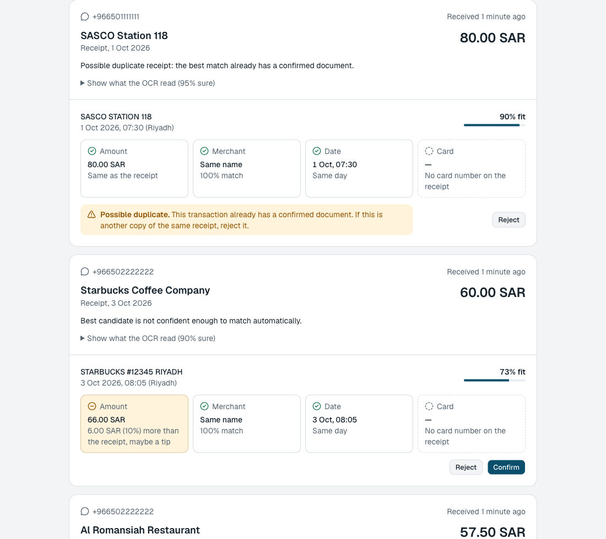
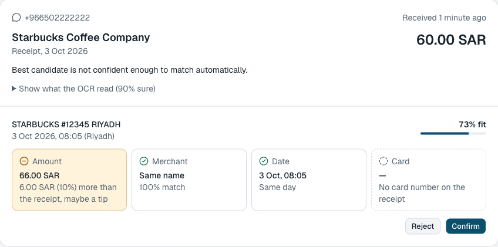
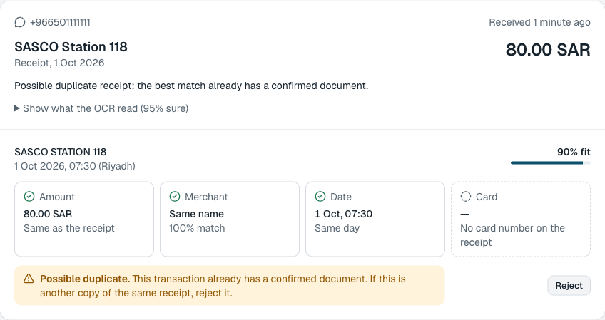
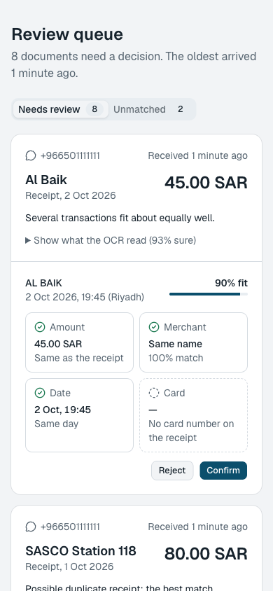

# Darb Portal: receipt and invoice matching

Documents arrive by email and WhatsApp webhooks, are OCR'd (mocked by default), and are matched to card
transactions with a confidence score. High-confidence matches are attached automatically. Ambiguous ones go to a
review page. See [IMPLEMENTATION.md](IMPLEMENTATION.md) for how and why it works, including the scoring design,
thresholds, assumptions, trade-offs and threat model.

Stack: Next.js 15 (App Router), TypeScript (strict), Prisma 6 + SQLite, Zod 3, next-safe-action 8, Tailwind + shadcn/ui, Jest 29.

## Quick start

Requires Node 18.18+ (Next 15, Prisma 6); developed on Node 22.

```bash
npm install                  # also runs `prisma generate`
cp .env.example .env
npm run db:deploy            # apply migrations to ./dev.db
npm run db:seed              # demo clients, drivers and transactions
npm run dev                  # http://localhost:3000  (redirects to /review)
```

### Try it end to end

With the dev server running, in a second terminal:

```bash
./scripts/send-fixtures.sh   # sends the demo fixtures and the assignment's two sample payloads through the real webhooks, then prints the outcome of each
```

Or use [webhooks.http](webhooks.http) (VS Code REST Client / JetBrains), or import
[postman/darb-portal.postman_collection.json](postman/darb-portal.postman_collection.json) into Postman. The collection
has 24 requests with assertions, covers every endpoint and the failure cases (duplicates, unknown sender, invalid
payloads, forged signature, oversized/fractional values), has an "Assignment sample payloads" folder with the assignment's
own email and WhatsApp bodies (and the email with its literal `<base64>` placeholder, which is a clean 400), and signs each POST body for you. To sign, set the collection
variables `emailSecret`, `whatsappSecret`, `transactionsSecret`, `verifyToken` to the same values the server was started
with and `serverHasSecrets` to `true`; leave them empty for an unsigned dev server. Change `runId` to send fresh message ids.
Two ready-made environments sit next to it. Import the collection and **one** environment, and select it:

| Environment | Use it when | Server must be started with |
|---|---|---|
| `darb-portal.local-unsigned.postman_environment.json` | plain `npm run dev` (no secrets): requests are sent unsigned | nothing extra |
| `darb-portal.local-signed.postman_environment.json` | you want HMAC signing exercised | `EMAIL_WEBHOOK_SECRET=demo-email-secret WHATSAPP_APP_SECRET=demo-whatsapp-app-secret TRANSACTIONS_WEBHOOK_SECRET=demo-transactions-secret WHATSAPP_VERIFY_TOKEN=demo-verify-token npm run dev` |

The sample values are demo-only: change them freely, but the server and the environment must hold the **same** secrets,
and `serverHasSecrets` must say whether the server has them (`true`/`false`), otherwise requests get 401 (or the
"forged signature" request wrongly passes). Headless: `npx newman run postman/darb-portal.postman_collection.json -e postman/darb-portal.local-unsigned.postman_environment.json`. Then open <http://localhost:3000/review>
to confirm or reject the candidates the matcher was not sure about.

To exercise HMAC signing, set the secrets for both the server and the script:

```bash
export EMAIL_WEBHOOK_SECRET=e WHATSAPP_APP_SECRET=w TRANSACTIONS_WEBHOOK_SECRET=t WHATSAPP_VERIFY_TOKEN=v
npm run dev                      # terminal 1 (inherits the variables)
./scripts/send-fixtures.sh       # terminal 2, signs every request with the same secrets
```

The script is safe to re-run (message ids are unique per run). To start from a clean slate run `npm run db:seed` again;
it wipes and re-creates the demo data. On a freshly seeded database the results table should show, among others:

| Sent | Result |
|---|---|
| the `alfanar_invoice` email, in the assignment's own shape (from `billing@alfanar-fuel.com.sa`) | `MATCHED`, auto-confirmed to `txn_alfanar` |
| `restaurant_tip` by WhatsApp (57.50 against 63.25) | `NEEDS_REVIEW` / `BELOW_AUTO_THRESHOLD`, flag "tip suspected", candidate `txn_restaurant` |
| `already_confirmed` (its transaction already has a confirmed document) | `NEEDS_REVIEW` / `POSSIBLE_DUPLICATE`, candidate `txn_confirmed`, Confirm hidden |
| `exact` by email after it was matched by WhatsApp | `NEEDS_REVIEW` / `POSSIBLE_DUPLICATE`, candidate `txn_exact` (cross-channel duplicate) |
| the assignment's WhatsApp sample (number `966551234567` is not a seeded driver) | `UNMATCHED` / `NO_CANDIDATES_IN_SCOPE` |
| `no_transaction`, then its card transaction through the feed | `UNMATCHED`, then `MATCHED` by the re-match |

## The review page

`/review` lists every document the matcher could not attach on its own, oldest first. For each candidate transaction it
says *how* the receipt agrees or differs (amount, merchant, date, card), so the reviewer decides on facts, not on a score.



A charge that is higher than the receipt is flagged as a possible tip, with the size of the difference:



A transaction that already has a confirmed document can never be confirmed a second time. It is shown as a possible
duplicate and only offers Reject:



It works on a phone too:



The screenshots show the demo data from `npm run db:seed` plus `./scripts/send-fixtures.sh`.

## Tests and checks

```bash
npm test             # 884 tests, ~1 s. Matcher and helpers need no DB; ingestion/handler/action tests use a real SQLite file per test file
npm run typecheck
npm run lint
npm run build
```

## Endpoints

| Endpoint | Purpose | Signature header (HMAC-SHA256 of the raw body) |
|---|---|---|
| `POST /api/webhooks/email` | Provider-neutral JSON: `messageId`, `from`, `to` (one address as a string, as in the assignment, or a list), `attachments[]` (base64) | `x-signature-256: sha256=<hex>` |
| `GET /api/webhooks/whatsapp` | Meta subscription handshake (`hub.challenge`) | n/a (verify token) |
| `POST /api/webhooks/whatsapp` | Meta Cloud API envelope, image and document messages. The envelope extras (`object`, `entry[].id`, `field`, `messaging_product`, `metadata`) are optional, because the assignment's sample has none of them | `x-hub-signature-256: sha256=<hex>` |
| `POST /api/webhooks/transactions` | Card transaction feed. New transactions trigger re-matching of unmatched documents | `x-signature-256: sha256=<hex>` |
| `/review` | Review page, two tabs (Needs review, Unmatched): ranked candidates, confirm / reject. A candidate whose transaction already has a confirmed document is a **possible duplicate** and can only be rejected | none (see limitations) |

Responses: `200` accepted/ignored/duplicate, `400` invalid payload (field paths only), `401` bad signature,
`413` body too large, `503` + `Retry-After` when the provider should retry. Request-handling errors are mapped to 4xx/503. The one remaining `500` path is a misconfigured environment (e.g. production without its secrets), which deliberately refuses to serve.

## Configuration

See [.env.example](.env.example). Everything is validated lazily by `lib/env.ts`.

| Variable | Notes |
|---|---|
| `DATABASE_URL` | SQLite file, relative to the project root |
| `EMAIL_WEBHOOK_SECRET`, `WHATSAPP_APP_SECRET`, `TRANSACTIONS_WEBHOOK_SECRET`, `WHATSAPP_VERIFY_TOKEN` | **Required when `NODE_ENV=production`** (fail closed: the app errors on first use rather than serving unauthenticated). Outside production a missing secret skips that check and logs a warning |
| `WHATSAPP_ACCESS_TOKEN` | Used to download media from Meta. Without it, development uses a fixture-backed `MediaStore`: a media id such as `media_4471` is looked up in `fixtures/media-map.json`. **In production a missing token makes WhatsApp media fetches fail with 503** |
| `EXTRACTOR` | `mock` (default) or `claude`. `claude` requires `ANTHROPIC_API_KEY` and **fails on first use without it** instead of falling back to the mock |
| `LOG_LEVEL`, `LOG_FORMAT` | `info`/`warn`/`error` (default `info`). `pretty` or `json`; default is pretty under `npm run dev` and JSON lines otherwise. `NO_COLOR=1` disables colours |
| `BLOB_DIR`, `MAX_BODY_BYTES` | Where document bytes are stored (content-addressed) and the request size cap (default 10 MB) |

## Logs

Under `npm run dev` logs are one readable line per event; in production they are JSON lines (`warn`/`error` go to stderr):

```
20:58:33.882 INFO  webhook.accepted  requestId=e2a1… endpoint=whatsapp messages=1 documents=1 duplicates=0 skipped=0
20:58:33.902 INFO  document.processed  requestId=e2a1… messageId=wamid.… documentId=cmv8… outcome=AUTO_MATCHED reason=CLEAR_WINNER extractionMs=1 matchMs=6 durationMs=20
20:58:36.615 WARN  document.extraction_failed  requestId=0857… documentId=cmv8… reason=FIXTURE_FORCED_FAILURE
```

Every webhook request gets a `requestId` that is carried into its background processing, so `grep requestId=…` follows one
message end to end. Events: `webhook.accepted` / `webhook.rejected` (reason: `bad_signature`, `invalid_payload`,
`too_large`, …) / `webhook.ignored` / `webhook.retry_requested`, `document.processed` (with extraction and matching
timings) / `document.extraction_failed`, `rematch.done`, `review.decided`. Logs carry ids, outcomes, counts, durations
and short codes only. Never document text, phone numbers, sender addresses, merchant names, tokens, signatures or error
messages; the logger redacts known-sensitive field names itself, and a test runs every fixture through every webhook and
asserts none of that appears. The one deliberate exception is the provider's message id (an email `Message-ID` or a
WhatsApp `wamid`), which is what lets you trace a message with the provider.

## Inspecting the database

The database is the SQLite file `./dev.db`. Prisma Studio works with it (`npx prisma studio`, which reads `DATABASE_URL`
from `.env`), but it can edit rows, so to look without any risk of disturbing the running server open the file
read-only with the `sqlite3` CLI (or any SQLite GUI: DB Browser for SQLite, TablePlus, the VS Code "SQLite Viewer"
extension):

```bash
sqlite3 -readonly -header -column dev.db
```

Useful queries (the table is called `"Transaction"`, quoted, because it is a reserved word in SQLite):

```sql
-- where every document ended up
select status, count(*) as n from Document group by status order by n desc;

-- each document with its live matches
select substr(d.id,-6) as doc, d.source, d.status, ifnull(d.matchReason,'-') as reason,
       ifnull((select group_concat(transactionId||':'||status,' ') from DocumentMatch m
               where m.documentId=d.id and m.status<>'REJECTED'),'-') as matches
from Document d order by d.receivedAt desc limit 10;

-- what the OCR extracted, and why a match scored the way it did
select json_extract(extraction,'$.merchantName') as merchant, json_extract(extraction,'$.totalAmount')/100.0 as amount,
       json_extract(extraction,'$.documentDate') as date, extractionConfidence as conf from Document where extraction is not null;
select transactionId, round(score,4) as score, json_extract(signals,'$.amount') as amt, json_extract(signals,'$.merchant') as mer,
       json_extract(signals,'$.date') as dat, json_extract(signals,'$.flags') as flags, status
from DocumentMatch order by score desc;

-- the key invariant: must return no rows
select transactionId, count(*) from DocumentMatch where status in ('AUTO_CONFIRMED','CONFIRMED') group by 1 having count(*)>1;

-- transactions with no confirmed document yet
select t.id, t.merchantName, t.amountMinor/100.0 as amount from "Transaction" t
where not exists (select 1 from DocumentMatch m where m.transactionId=t.id and m.status in ('AUTO_CONFIRMED','CONFIRMED'));
```

`npm run db:seed` resets the data (it wipes and re-creates the demo rows).

## Seed data and fixtures

`npm run db:seed` creates two clients, three drivers, 15 transactions (the assignment's own examples among them: `ALFANAR FUEL ST 04 RUH` for 287.50 and a restaurant charge of 63.25, plus three unrelated "noise" transactions) and three registered email senders. One of them, `billing@alfanar-fuel.com.sa`, is a demo mapping to Al Noor so that the assignment's sample email payload is accepted. The mock extractor recognises the 15 fixture
files in [`fixtures/`](fixtures/README.md) by SHA-256 (`npx tsx scripts/print-fixtures.ts` lists them). `fixtures/` is the
single source of truth: `documents/<name>.fixture` is the "file" that arrives, `extractions/<name>.json` is the
assignment's `ExtractedDocument` the mock returns for it, `media-map.json` maps WhatsApp media ids (`media_4471`, ...) to
files, and `webhooks/` holds sample request bodies. The loader needs the server to run from the project root. Each fixture
exercises a matcher edge case: exact match, two identical transactions (ambiguous), the same pair disambiguated by card
last4, tip, rounding, pre-VAT total, no matching transaction, garbage extraction, low OCR confidence, an Arabic merchant,
an already-confirmed transaction (a possible duplicate, so it goes to review), a forced extractor failure, the assignment's sample tax
invoice (auto-matched, merchant `Alfanar Fuel Station` against `ALFANAR FUEL ST 04 RUH`), and the assignment's restaurant tip (57.50 against 63.25, review).
The same receipt sent by a second channel after it was matched (for example WhatsApp, then email) also lands in review as a possible duplicate.

## Layout

```
app/api/webhooks/*       thin route files (wiring only)
app/review/              review page and client components
lib/prisma.ts            the PrismaClient singleton (default export; `db` is the same object). lib/prisma-client.ts builds a client for scripts and tests
lib/logger.ts            structured logger (`log`, `consoleLogger`)
lib/webhooks/            HMAC, Zod schemas, body reader, handlers (testable without Next)
lib/services/            ingestion, match pipeline, matcher (pure), re-match, blob store, media store (WhatsApp Cloud API | fixtures)
lib/matching/            normalization, similarity, per-signal scoring (pure)
lib/extraction/          DocumentExtractor interface, MockExtractor, fixtures loader, ClaudeExtractor
fixtures/                the mock's documents, extractions, media map and sample webhook bodies
lib/actions/             review confirm/reject (core logic, safe-action-client.ts = `actionClient`, and the next-safe-action wrappers)
prisma/                  schema, migration (with the partial unique index), seed
__tests__/               matcher, helpers, ingestion, handlers, actions, db constraints
```

## Notes

- `ClaudeExtractor` is covered by unit tests with a stubbed client only. It has **not** been run against the real API.
- The review actions and `/review` page have no authentication. They are intended to sit behind the portal's existing auth.
- Dependency notes (Prisma 6, Zod 3, Jest 29 per the assignment's stack; Next 15 audit advisory) are in IMPLEMENTATION.md.
- `DATABASE_URL` is `file:../dev.db`: a relative SQLite path is resolved against `prisma/` (the Prisma CLI's rule), so this is `./dev.db` at the project root. The app resolves it itself (`resolveDatabaseUrl` in `lib/prisma-client.ts`) because inside Next's bundled server Prisma's own resolution pointed under `.next/` and failed with `Error code 14: Unable to open the database file`.
